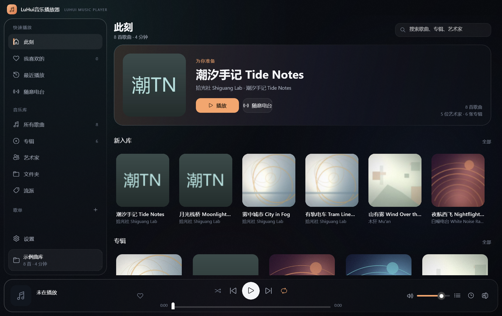

# LuHui Music Player (LuHui音乐播放器)

[中文说明](README.md) · **English**

<p>


</p>

A local music player for Windows: a **WinUI 3** shell, a **loopback-only Python audio service**, and
**WASAPI** output with optional bit-perfect exclusive mode. It reads local files only — no streaming,
no scraping, no accounts, no DRM.



> An independent reimplementation inspired by Salt Player's layout and workflow.
> It shares no code or artwork with Salt Player and is not affiliated with it.

## Highlights

- **Native shell, not a web wrapper.** WinUI 3 / .NET 8 with a hand-drawn title bar, sidebar and transport.
- **Local audio service.** Python listens on `127.0.0.1` only: library scan, tags, cover art, lyrics,
  SQLite, and playback through the non-native engine.
- **WASAPI output.** Shared or exclusive; exclusive bypasses the system mixer and can follow the source
  sample rate for bit-perfect output. TPDF dither only when a 24-bit source lands in a 16-bit container.
- **DSP**: 10-band EQ, loudness normalisation, balance, fade-in, 0.5–2× speed.
- **Library**: incremental scan, album/artist/folder/genre, A–Z jump, search, favourites, playlists, queue.
- **Lyrics**: embedded, sidecar `.lrc`, manual attach; `[offset:]`, multiple timestamps per line, bilingual
  second line; lyrics page, rolling lyrics in the bar, fullscreen lyrics, always-on-top desktop lyrics.
- **Details**: resume where you left off, tray + media keys, SMTC, colour from cover art, dark/light theme,
  close-to-tray, four play modes.

## Formats

Playable: `.mp3 .flac .m4a .mp4 .aac .wav .ogg .oga .opus .aiff .aif`.

`wma / ape / dsd / wv` appear in the library only if you enable "include unplayable formats"; whether they
actually decode depends on the FFmpeg build on your machine. The UI never claims "scanned" means "playable".

## Build from source

Needs **Windows 10 1809+ / 11 x64** and **Python 3.10+**.

```bat
git clone https://github.com/gedouluhui/luhui-music-player.git
cd luhui-music-player
python -m pip install -r requirements.txt
```

Native shell (recommended; needs .NET SDK 8, Windows App SDK restores via NuGet):

```bat
dotnet build native\SaltPlayer.Native\SaltPlayer.Native.csproj -c Release -p:Platform=x64
```

Output: `native\SaltPlayer.Native\bin\x64\Release\net8.0-windows10.0.19041.0\win-x64\LuHuiMusic.exe`.
The shell finds `salt_player.py` next to the project and launches it with the system Python;
set `SALTPLAYER_PYTHON` if Python isn't on PATH.

Browser / dev mode (no build step, edit `web/` and refresh):

```bat
python salt_player.py --server
```

## Data location

`%LOCALAPPDATA%\SaltPlayerPro\` — `library.sqlite3`, `settings.json`, `server.port`, `crash.log` (only if
something failed). The folder name predates the rename on purpose: upgrading never wipes your library.
Set `SALTPLAYER_DATA` to relocate the whole data root.

## Known limits

- Windows only: WASAPI, WinUI 3 and a few Win32 calls have no portable replacement.
- Exclusive mode locks the machine's audio and driver support for sample-rate/bit-depth combos varies;
  the UI reports what this machine actually negotiated, not a promise.
- The repo ships source only — no packaged exe, no sample library, no `bin/obj/dist`.
- The legacy Qt shell embeds Chromium 87 and lacks newer CSS; use the native shell for UI work.

## License

**GNU GPL v3.0** — see [LICENSE](LICENSE). One reason for GPLv3: the legacy Qt shell depends on GPL PyQt5.
Third-party components: [THIRD_PARTY_NOTICES.md](THIRD_PARTY_NOTICES.md). FFmpeg binaries are not committed;
`imageio-ffmpeg` provides a runtime build whose licence depends on the build (LGPL 2.1+ or GPL 2+).

## Feedback

Open an [issue](../../issues) with your Windows version, player version/commit, sound card and driver,
whether exclusive mode was on, and `%LOCALAPPDATA%\SaltPlayerPro\crash.log` if present.

---

## More from the same author

- [LuHui Player](https://github.com/gedouluhui/luhui-player) — a Windows video player built on mpv with a hand-drawn Fluent UI
- [Fanqie Alarm](https://github.com/gedouluhui/fanqie-alarm) — a Pomodoro timer that is one HTML file
- [pc-phone-proxy](https://github.com/gedouluhui/pc-phone-proxy) — auto-selecting proxy for Windows and Android
