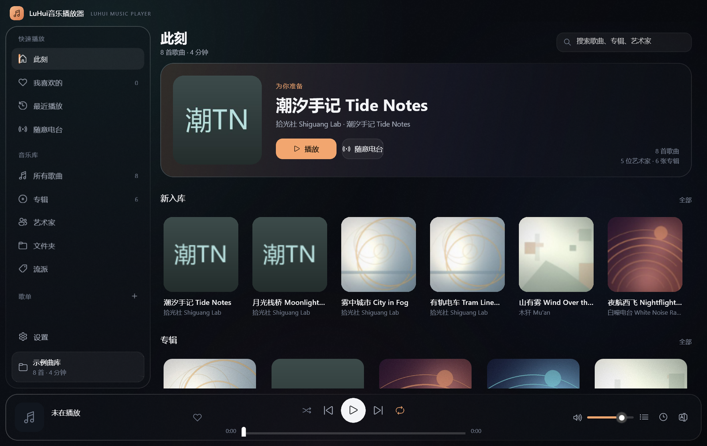

# LuHui音乐播放器（LuHui Music Player）

**中文** · [English](README.en.md)

**Windows 本地音乐播放器：WinUI 3 原生外壳 + 本地 Python 音频服务 + WASAPI 输出。**

<p>


</p>

*A local music player for Windows: a WinUI 3 shell, a loopback-only Python audio service, and WASAPI output with optional bit-perfect exclusive mode.*

宽屏三栏、原生控件、深浅主题、歌词与歌单、独占输出与逐位直通。只读本机文件：
不联网、不上传、不抓取音源、不碰 DRM。所有曲库与设置都留在这台机器上。



## 目录

[亮点](#亮点) · [支持的格式](#支持的格式) · [快速开始](#快速开始源码) · [数据放在哪里](#数据放在哪里) ·
[结构](#结构) · [开发与自检](#开发与自检) · [已知限制](#已知限制) · [许可](#许可)

> 这是按椒盐音乐（Salt Player）的功能与交互**独立重写**的实现，
> 不含椒盐音乐的任何代码或美术素材，与椒盐音乐官方无关。

## 亮点

- **原生外壳**：WinUI 3 / .NET 8，自绘标题栏、侧栏与播放条；不是套壳浏览器。
- **本地音频服务**：Python 只监听 `127.0.0.1`，负责扫描建库、标签/封面/歌词、
  SQLite 与非原生引擎的播放控制。窗口与后端在同一台机器上，没有账号与云端。
- **WASAPI 输出**：共享或独占；独占模式绕过系统混音器，可跟随源采样率做逐位直通，
  24 位源落进 16 位容器时才启用 TPDF 抖动。设备能力与是否真的 bit-perfect 由引擎逐项计算。
- **十段均衡器 / 响度均衡 / 左右平衡 / 淡入 / 0.5–2× 变速**，原生档在服务端 DSP，
  浏览器档走 WebAudio。
- **曲库**：增量扫描、专辑/艺术家/文件夹/流派、A–Z 拼音快跳、搜索、收藏、歌单、队列。
- **歌词**：内嵌歌词、同名 `.lrc`、手动挂载；`[offset:]`、一行多时间标签、双语第二行；
  歌词页、播放条滚动歌词、全屏歌词、置顶桌面歌词小窗。
- **细节**：接着上次听、托盘与媒体键、系统媒体控件（SMTC）、封面取色、深浅主题、
  关闭到托盘、单曲/列表/随机/顺序四种播放模式。

## 支持的格式

可播放：`.mp3 .flac .m4a .mp4 .aac .wav .ogg .oga .opus .aiff .aif`。

`wma / ape / dsd / wv` 等格式在设置里打开「包含无法播放的格式」后会出现在曲库中；
原生引擎基于 FFmpeg，实际能否解码取决于本机 FFmpeg 构建，界面不会把「能扫到」说成「能播」。

## 快速开始（源码）

需要 **Windows 10 1809+ / 11 64 位** 与 **Python 3.10+**（开发机 3.12.3）。

```bat
git clone https://github.com/gedouluhui/luhui-music-player.git
cd luhui-music-player
python -m pip install -r requirements.txt
```

### 方式一：原生外壳（推荐）

需要 .NET SDK 8 与 Windows App SDK（NuGet 自动还原）：

```bat
dotnet build native\SaltPlayer.Native\SaltPlayer.Native.csproj -c Release -p:Platform=x64
```

产物在：

```
native\SaltPlayer.Native\bin\x64\Release\net8.0-windows10.0.19041.0\win-x64\LuHuiMusic.exe
```

双击即可。外壳会自动在项目里找到 `salt_player.py` 与 `sp/`，用系统 Python 拉起本地服务；
找不到 Python 时可设 `SALTPLAYER_PYTHON` 指向 `python.exe`。

### 方式二：浏览器 / 开发模式

```bat
python salt_player.py --server
```

它会打印 `http://127.0.0.1:端口`，用浏览器打开即可。适合改 `web/` 下的前端：
没有构建步骤，改完刷新。首次取回网页资产需要本机服务在跑，之后核心播放不依赖外网。

### 方式三：旧版 Qt 外壳（可选）

```bat
python -m pip install -r requirements-qt.txt
python salt_player.py
```

PyQt5 + QtWebEngine 的旧外壳仍保留，方便在 Chromium 87 内核下调试网页 UI。
注意它不支持 `aspect-ratio`、`:has()`、`color-mix()` 等新 CSS，前端改动请以原生外壳为准。

## 数据放在哪里

```
%LOCALAPPDATA%\SaltPlayerPro\
├─ library.sqlite3      曲库、歌单、收藏、播放记录
├─ settings.json        外观/播放/音频设备等设置
├─ server.port          当前后端监听的端口
└─ crash.log            出过错才有的日志
```

目录名沿用旧标识 `SaltPlayerPro`，**升级不会迁移或清空已有曲库**。
想彻底重来：退出程序后删掉这个文件夹即可，封面缓存会自动重建。

设置 `SALTPLAYER_DATA` 可把数据根换到别处（测试与多实例隔离用）；
`SALTPLAYER_BACKEND_DIR`、`SALTPLAYER_PYTHON` 可覆盖后端目录与解释器路径。

## 结构

```
salt_player.py              启动器：默认开 Qt 外壳，--server 只跑本地服务
sp/                         Python 后端：扫描、标签、SQLite、HTTP API、WASAPI 引擎
web/                        浏览器 UI（原生外壳不加载它，开发/浏览器模式用）
native/SaltPlayer.Native/   WinUI 3 外壳（C# / XAML）
tools/                      示例曲库生成器与离线自检
```

音频链路（原生引擎）：

```
文件 → FFmpeg 解码 → float32 PCM → numpy/scipy DSP（EQ/响度/平衡/淡入/变速）
     → WASAPI 共享或独占（手写 COM，sp/wasapi.py）
```

网页 UI 的链路是 `<audio>` + WebAudio，两条链路共用同一套设置与界面语义。

## 开发与自检

```bat
python tools\gen_demo.py       :: 重新生成 示例曲库（8 首全合成音频 + LRC + 封面）
python tools\test_lyrics.py    :: LRC 解析检查（读 示例曲库）
python tools\test_audioplay.py :: 原生引擎离线自检（DSP/环形缓冲/seek/独占协商；不开设备）
```

`test_audioplay.py` 会优先用曲库里的 FLAC/WAV；没有库时用临时生成的 WAV 夹具，
不会改动你的曲库，也不会打开音频设备。

无前台启动核验（私有桌面 + 截图，需 `pywin32` / `psutil`）：

```bat
python native\run_native_hidden.py path\to\LuHuiMusic.exe
```

## 已知限制

- 仅支持 Windows：WASAPI、WinUI 3 与部分 Win32 调用没有跨平台替代。
- 独占模式会锁住整机声音，且不同声卡/驱动对采样率与位深组合的支持差异很大；
  界面显示的是本机实测能力，不保证每台机器都能逐位直通。
- 「包含无法播放的格式」只影响是否入库；能不能出声仍取决于 FFmpeg 构建。
- 仓库只含源码，不含打包好的 exe、示例曲库、`bin/obj/dist` 与本机生成的启动脚本。
- 旧版 Qt 外壳的 Chromium 87 内核不支持部分新 CSS；原生外壳不受此限制。

## 许可

**GNU General Public License v3.0**，见 [LICENSE](LICENSE)。选择 GPLv3 的原因之一是
旧版 Qt 外壳依赖 GPL 版 PyQt5；原生外壳与后端同样按 GPLv3 分发。
第三方组件与许可见 [THIRD_PARTY_NOTICES.md](THIRD_PARTY_NOTICES.md)。

FFmpeg 二进制不随本仓库提交：`imageio-ffmpeg` 在安装时提供运行时构建，
其许可取决于具体构建（LGPL 2.1+ 或 GPL 2+）。

## 反馈

提 [Issue](../../issues) 时请附：Windows 版本、播放器版本（或 commit）、声卡/驱动型号、
是否开了独占模式，以及 `%LOCALAPPDATA%\SaltPlayerPro\crash.log`（出过错才有）。

---

## 同作者的其他项目

- [LuHui播放器](https://github.com/gedouluhui/luhui-player) —— mpv 内核 + 手绘 Fluent 外壳的本地视频播放器
- [番茄闹钟](https://github.com/gedouluhui/fanqie-alarm) —— 整个应用就是一个 HTML 的番茄钟
- [pc-phone-proxy](https://github.com/gedouluhui/pc-phone-proxy) —— 电脑 + 安卓双端自动选线代理
